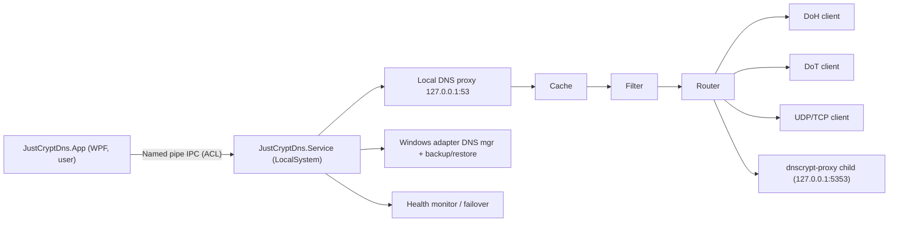

# JustCryptDns — Technical Implementation Plan

## 1. Environment (inspected 2026‑11‑07)

| Item | Finding | Consequence |
|---|---|---|
| OS | Windows 10 22H2 (10.0.19045) x64 | Win11 Mica/Acrylic (`DWMWA_SYSTEMBACKDROP_TYPE`) **not available locally** → Win10 blur fallback must be first-class and tested here; Win11 path guarded by build check (≥ 22621). |
| SDK | .NET SDK 10.0.402 | Builds `net8.0-windows` fine (SDK is backward-targeting). |
| Runtimes | Microsoft.WindowsDesktop.App 8.0.33 present | App can be run framework-dependent during development; release = self-contained. |
| NuGet | nuget.org reachable | Packages restorable. |
| Tooling | git 2.56; no Inno Setup / WiX / NSIS | Installer tooling (Phase 12) will need to be installed; decided then. |

## 2. Solution layout

```
JustCryptDns.sln
Directory.Build.props            (net8.0, x64, nullable, analyzers, common metadata)
src/
  JustCryptDns.Core/             net8.0          models, interfaces, settings schema + migration, IPC contracts
  JustCryptDns.DNS/              net8.0          wire format, UDP/TCP/DoH/DoT clients, local proxy, routing, filtering, cache, dnscrypt-proxy mgmt
  JustCryptDns.Network/          net8.0          benchmark, gaming, diagnostics, failover, monitoring
  JustCryptDns.Infrastructure/   net8.0-windows  Windows adapters/DNS (WMI/IP Helper/netsh fallback), startup, process, storage, logging
  JustCryptDns.Service/          net8.0-windows  Windows Service host (Phase 3)
  JustCryptDns.App/              net8.0-windows  WPF MVVM UI
tests/
  JustCryptDns.Tests/            xUnit, offline-only
installer/ docs/                 (Phase 12)
```

Dependency direction: `App → Infrastructure/Network/DNS → Core`; `Service → Infrastructure/Network/DNS → Core`. Core has no Windows/UI dependencies.

## 3. Key technology decisions

| Concern | Choice | Reason |
|---|---|---|
| MVVM | **CommunityToolkit.Mvvm** (Microsoft, source generators) | No runtime reflection, small footprint. |
| DI | Microsoft.Extensions.DependencyInjection | Required. App uses plain `ServiceProvider` (no Generic Host → lower RAM). Service uses Generic Host + `UseWindowsService`. |
| Logging | Serilog + Serilog.Sinks.File via `Microsoft.Extensions.Logging` abstractions | Libraries depend only on `ILogger<T>`; rolling files, size cap, retention. |
| Config | System.Text.Json, versioned schema (`SchemaVersion`), migration chain on `JsonNode`, atomic write (temp + `File.Replace` + `.bak`) | Safe migration, corruption recovery. |
| Localization | `.resx` (en, vi) + runtime `LocalizationManager` indexer binding (`{l:Loc Key}`) | Language switch without restart; no UI text in ViewModels (VMs expose keys/enums). |
| Theming | Swappable `ResourceDictionary` (Dark/Light), all colors via `DynamicResource`, accent brushes generated at runtime | Live switching. |
| Window | `WindowChrome` custom chrome; backdrop: Win11 → DWM Mica/Acrylic; Win10 → `SetWindowCompositionAttribute` blur; fallback → solid. Transparency 0–90 % maps to surface alpha. | Mandatory transparency feature with graceful fallback. |
| DNS wire format | Own minimal RFC 1035 parser/encoder (no crypto) | Needed for proxy, cache, routing, filtering; small and testable. |
| DoH / DoT | `HttpClient` (HTTP/2, RFC 8484) shared via `SocketsHttpHandler`; `SslStream` for DoT (RFC 7858) | Built-in TLS; no custom crypto. |
| DNSCrypt | **dnscrypt-proxy** (official release, SHA-256/minisign verified) as child process managed by the service, bound to an internal port; JustCryptDns proxy forwards DNSCrypt-routed queries to it | Required: no own crypto implementation. |
| Tray | Lightweight own `Shell_NotifyIcon` P/Invoke wrapper (no WinForms) | Avoids ~10 MB WinForms load. |
| IPC | Named pipe, ACL restricted to the interactive user + SYSTEM, length-prefixed JSON messages, versioned contracts | Secure local IPC. |
| Startup | Service: automatic (delayed) start; UI: `HKCU\...\Run` single entry (idempotent) with `--minimized` | No duplicates, easy disable. |
| Windows DNS | Read: `NetworkInterface`/IP Helper; Write: WMI `Win32_NetworkAdapterConfiguration` / `netsh` / registry for DoH templates (`netsh dns add encryption` on Win11) — performed by the elevated service only | Admin only where required. |

## 4. Runtime architecture (target, reached by Phase 4)



## 5. Phases

| # | Phase | Deliverables | Verification |
|---|---|---|---|
| 1 | Foundation & modern UI | Solution, DI, Serilog, versioned settings store, localization (en/vi), theme engine (dark/light/system), custom-chrome shell, collapsible sidebar, 9 pages, real network-adapter info on Dashboard, unit tests | Build, tests, launch + screenshot |
| 2 | Appearance & transparency | Appearance page: theme, transparency 0–90 % (backdrop engine), accent picker, sidebar mode, UI scale, font size, animation intensity, density, corner style, background, reset | Visual verification on Win10; Win11 path guarded |
| 3 | Service, tray, startup | Windows Service host, named-pipe IPC, tray icon + menu, close behavior, Run-key startup, start minimized | Install service locally (admin), IPC round-trip tests |
| 4 | DNS engine | Wire format, UDP/TCP/DoH/DoT upstreams, local proxy (port conflict + loop detection), dnscrypt-proxy download/verify/manage/update, Windows DNS apply/backup/verify/rollback, emergency restore | Real resolution through proxy, nslookup against 127.0.0.1 |
| 5 | Resolver management | Provider catalog (validated), CRUD, groups, import/export, health checks, dnscrypt `public-resolvers.md` parsing (signed) | Tests + live checks |
| 6 | Smart routing | Rule engine (exact/wildcard/suffix, priority), profiles, rule editor, rule tester, routing log | Tests |
| 7 | Filtering & cache | Blocklists (hosts/domain formats, validated), allowlist, temp exceptions, essential-domain protection, TTL cache (positive/negative, size cap, stats) | Tests |
| 8 | Gaming | Benchmark (avg/min/max/P95/success/timeout/score), 3 selection profiles, gaming profiles, Gaming Mode (session pinning) | Tests + real benchmark |
| 9 | Resilience | Failover policies, retry, UDP/TCP 53 blocking detection, handshake/DoH failure diagnostics, IPv4/IPv6 checks | Fault-injection tests |
| 10 | Diagnostics & monitor | Diagnostics page tools (lookup, DNSSEC, DoH/DNSCrypt test, comparison, leak test, propagation), virtualized live query log | Manual + tests |
| 11 | Resource optimization | Monitoring modes, perf diagnostics mode, measurements of RAM/CPU/startup | Recorded measurements |
| 12 | Testing & release | Remaining tests, self-contained publish, installer (Inno Setup proposed), portable ZIP, docs, licenses | Clean-machine install test |

## 6. Honesty rules applied throughout

- Features not yet implemented show an explicit **"Planned – Phase N"** state; no fake numbers.
- Status indicators only show "protected/healthy" after verification.
- DNS latency is never presented as game ping.

## 7. Open decisions (can be answered any time)

1. **License** for the project (MIT proposed).
2. **Installer technology** (Inno Setup proposed — simple, supports service install/uninstall).
3. Whether the **service runs as LocalSystem** (needed for adapter DNS changes and port 53) — proposed yes.
